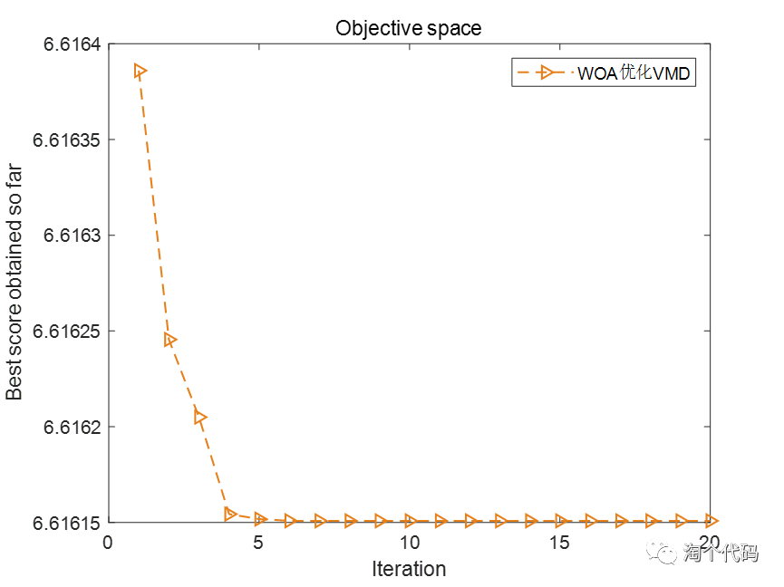
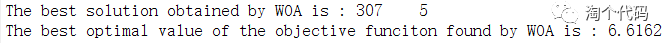
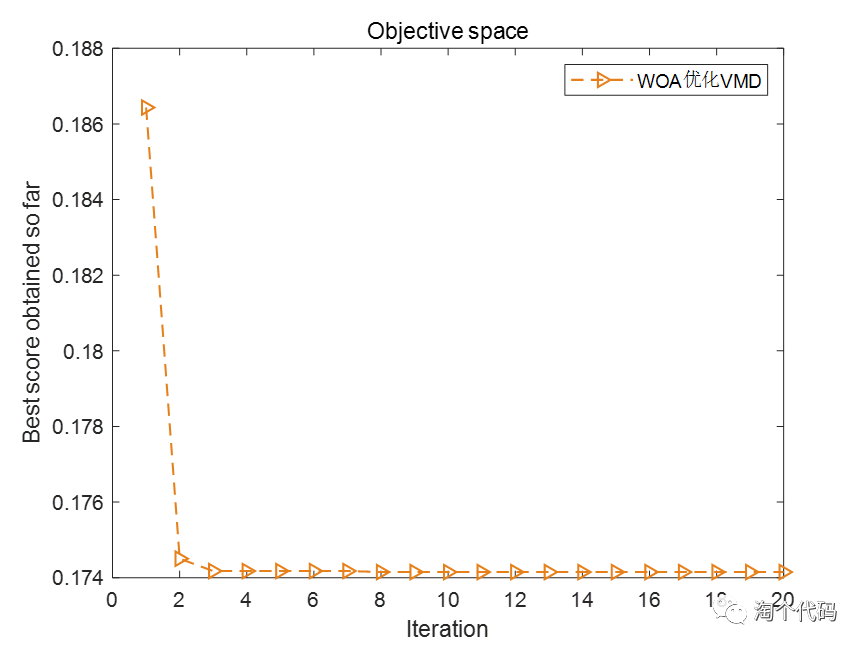
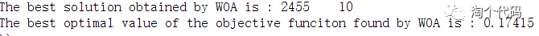
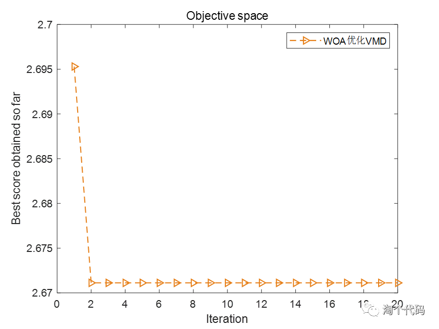
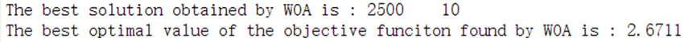
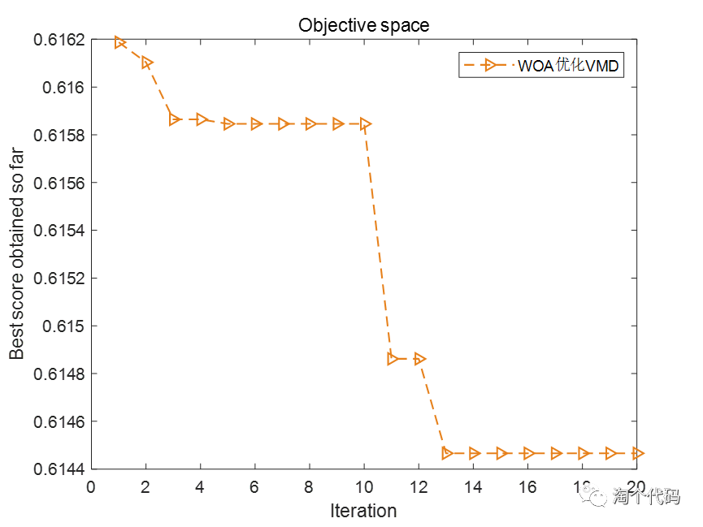
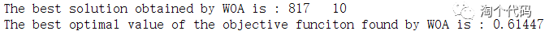

# WOA Optimization of VMD Parameters with Min Entropy, Sample Entropy, Information Entropy, Arrangement Entropy (Adaptation function can be selected by one-click modification) including MATLAB

Whale Optimization Algorithm (WOA) is a method proposed by Mirjalili based on the hunting behavior of humpback whales. The algorithm mimics the hunting behavior of humpback whales, searching for prey and then attacking to feed. This approach aims to optimize the results. Many scholars have applied this algorithm to real-world engineering problems. Today, we will use the WOA to optimize the VMD parameters.
Taking the Xichu University dataset as an example, we will select 1000 data points from the X105_BA_time.mat file in the 105.mat file.
We will choose four fitness functions for optimization, which are: minimum entropic capacity, minimum sample entropy, minimum information entropy, and minimum permutation entropy.
1. Minimal Entropic Capacity as the fitness function
2. Minimal Sample Entropy as the fitness function
3. Minimal Information Entropy as the fitness function
4. Minimal Permutation Entropy as the fitness function
Code:
%% Optimize VMD using WOA algorithm with minimum entropies as objective functions (choose one of them), to find the optimal two parameters for VMD.\nclear\nclc\nclose all\nxz = 4;  %xz=1 or 2, choose 1 with minimum entropic fitness function of the smallest package, choose 2 with minimum sample entropic fitness function, choose 3 with minimum information entropic fitness function, choose 4 with minimum permutation entropic fitness function\nif xz == 1  \n    fobj=@EnvelopeEntropyCost;          % Minimum Envelope Entropy\nelseif xz == 2\n    fobj=@SampleEntropyCost;            % Minimum sample entropy\nelseif xz == 3\n    fobj=@infoEntropyCost;              % Minimum Information Entropy\nelseif xz == 4\n    fobj=@PermutationEntropyCost;       % Minimum Arrangement Entropy\nend\n\n%% Selection of data\nload 105.mat\nda = X105_DE_time(6001:7000); % Here, select the DEtime data of 105. Note that you can replace this with your own data. The data should be in n rows * 1 column format, and the number of columns must be 1.\n\n%% Set parameters\nlb = [100 3];    % Penalty factor and the lower bound of K\nub = [2500 10];  % Penalty factor and the upper limit of K\ndim = 2;            % Optimize the number of variables\nMax_iter=20;       % Maximum number of iterations\nSearchAgents_no=25;       %Population size\n\n%% Call WOA function\n[fMin , bestX, Convergence_curve ] = WOA(SearchAgents_no,Max_iter,lb,ub,dim,fobj,da);\n\n%% Draw the fitness function curve and output the optimal parameters.\nfigure\nplot(Convergence_curve,'Color',[0.9 0.5 0.1],'Marker','>','LineStyle','--','linewidth',1);\ntitle('Objective space')\nxlabel('Iteration');\nylabel('Best score obtained so far');\nlegend('WOAOptimizationVMD')\ndisplay(['The best solution obtained by WOA is : ', num2str(round(bestX))]);  % Output the best location\ndisplay(['The best optimal value of the objective funciton found by WOA is : ', num2str(fMin)]);  % Output the best fitness value\nEveryone, pay attention to see.xzThis variable, when selected.1, Using the minimal entropic fitness function, select.2, Using the minimum sample entropy as the fitness function, select.3, Using minimal information entropy as the fitness function, select4, Use the minimum permutation entropy as the fitness function. This makes it very convenient for everyone to switch.。  

## Images

<!-- PAYMENT_BLOCK -->

## Get this dataset

- Payment link (Stripe): [Buy now](https://buy.stripe.com/3cs8yP7sY87d0vu9AB)
- Payment QR code: 

<!-- /PAYMENT_BLOCK -->
